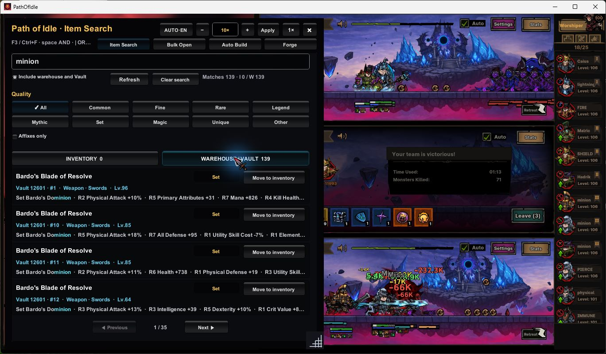
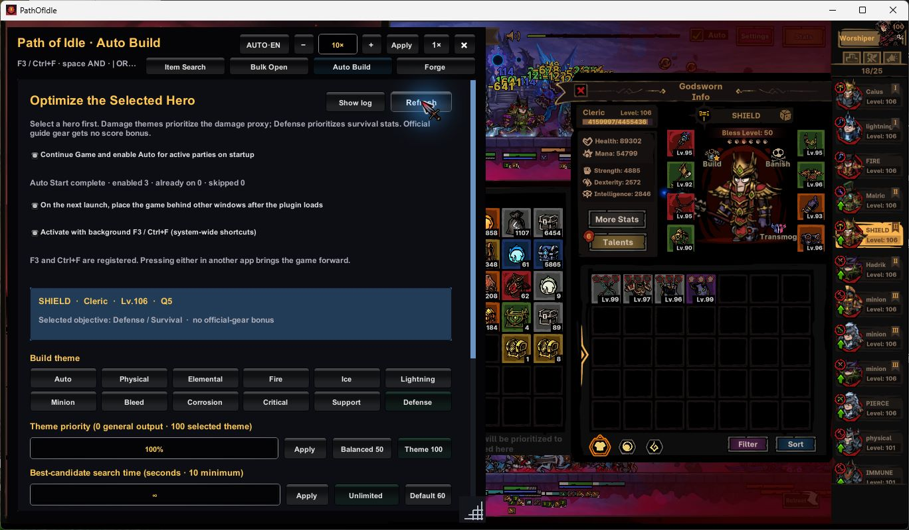
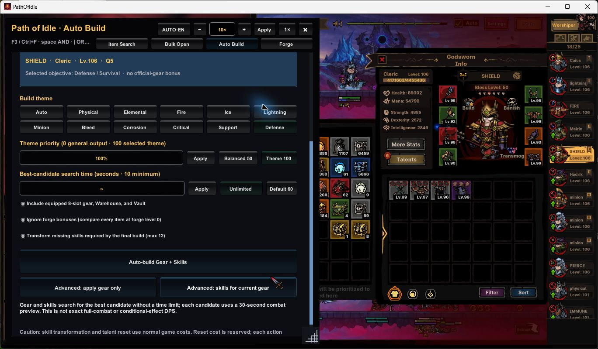
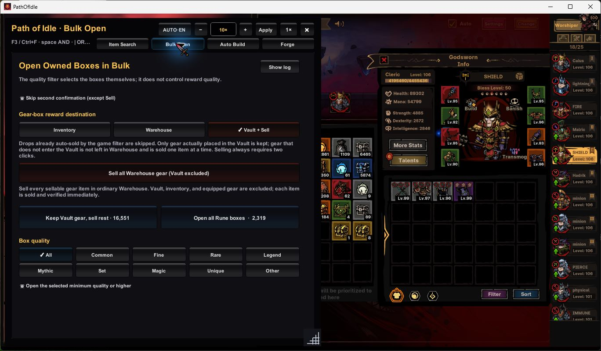
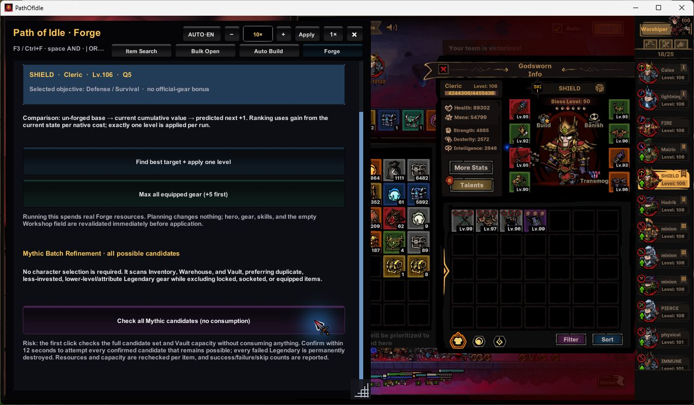

# Path of Idle 인게임 검색

[English](README.md) · **한국어** · [简体中文](README.zh-CN.md) · [繁體中文](README.zh-TW.md)

게임 안에서 아이템 검색, 장비·스킬 자동 구성, 상자 개봉, 창고 정리와 강화를 사용하는 비공식 Windows 모드입니다. 브라우저 대시보드나 별도 서버는 필요하지 않습니다.

**[최신 버전 다운로드](https://github.com/Hangeulkim/PathOfIdleInGameSearch/releases/latest)** · [전체 기능·상세 예시](GUIDE.md) · [변경 기록](CHANGELOG.md)

독립 저장소는 **Hangeulkim/PathOfIdleInGameSearch**입니다. **1.1.9**에는 Healer 등 타 직업 스킬 보유 캐릭터의 자동 장착 수정이 포함됩니다. 이전 `path-of-idle-stats` 링크는 잘못된 배포 위치였습니다. 소스와 다운로드는 이 저장소를 이용해 주세요.

## 설치·업데이트

1. Releases에서 `PathOfIdleInGameSearch-v1.1.9.zip`을 받고 완전히 압축 해제합니다.
2. 게임 종료 후 `install.bat`을 실행합니다.
3. 게임을 켜고 **F3** 또는 **Ctrl+F**를 누릅니다.

설치기는 Steam 게임 위치와 DLL의 SHA-256을 확인하며 기존 설정을 보존합니다. BepInEx가 없을 때만 고정된 공식 BepInEx 6 IL2CPP x64를 다운로드해 검증합니다. 기존 BepInEx 사용자는 별도 DLL을 받아 게임 종료 상태에서 `BepInEx/plugins`에 복사해도 됩니다.

자동화 전, 특히 게임 업데이트 후에는 세이브를 백업하세요. 초기화·스킬 변환·강화는 정상 게임 재화를 사용합니다. **판매와 신화 강화 실패에 따른 아이템 파괴는 되돌릴 수 없습니다.**

## 주요 기능과 예시

- **검색:** 인벤토리·일반 창고·Vault에서 이름, 등급, 부위, 레벨, 옵션, 세트로 검색하고 효과를 확인합니다. 이동은 게임의 창고 배치 규칙을 따릅니다. `critical damage -health`는 앞의 두 단어를 포함하고 health를 제외합니다. `|`는 OR, 따옴표는 구문 검색입니다.
- **Auto Build:** 장비 8부위, 스킬과 포인트 배분을 함께 비교하고 최종 장착 결과를 확인합니다. 스킬 변환을 켜면 정상 변환 비용을 사용합니다. 실제 보유한 Alien 스킬과 장비 부여 스킬은 구분합니다.
- **테마:** Auto, Physical, Elemental, Fire, Ice, Lightning, Minion, Bleed, Corrosion, Critical, Support, Defense. 우선도 0은 일반 성능, 100은 선택 컨셉을 중시하며 이름으로 장비나 세트를 강제하지 않습니다.
- **Fire 컨셉:** Fire와 높은 테마 우선도를 선택하고 창고/Vault 후보를 포함해 실행합니다. 실제 세트 효과와 전체 성능을 비교합니다.
- **소환 컨셉:** Minion을 선택합니다. Ally·Sentry·Totem은 이름만으로 합치지 않고 게임 태그, 소유 관계, 공격 타입과 상속 스탯으로 비교합니다.
- **방패·생존:** Defense를 선택합니다. 동일한 공격 조건에서 방어·회피·실드·회복·자원 소모·생존 시간을 비교합니다.
- **기존 강화 제외:** Ignore forge bonuses를 켜면 모든 장비의 핵심 수치를 강화 전으로 비교합니다. 실제 강화와 옵션·룬·세트 효과는 유지합니다.
- **상자·창고:** 등급별 일괄 개봉을 지원합니다. “Vault에 보관, 나머지 판매”는 Vault에 들어간 보상을 남기고 확인된 초과분을 즉시 판매합니다. 더 좋은 보상이 기존 장비를 밀어냈다면 밀려난 장비가 판매 대상입니다. 일반 창고 전체 판매는 Vault·인벤토리·장착 장비를 제외하는 별도 확인 작업입니다.
- **강화:** 다음 Forge 효율 비교, 장착 장비 최대 강화, 미장착 전설 장비의 신화 강화 일괄 검사. 신화 검사는 캐릭터 선택 없이 가능하며 매번 용량·재화를 확인하고 성공·실패·제외 횟수를 표시합니다.
- **화면:** 패널 이동·크기 조절, 4개 언어, 0.1~100배 직접 입력, 선택해서 보는 상세 로그. 백그라운드 시작·전역 단축키는 기본 꺼짐인 선택 기능입니다.

## 검색 화면에서 따라 하기

**Item Search** 검색창에 단어를 입력하고, 창고까지 찾으려면 **Include warehouse
and Vault**를 켭니다. 결과 위의 Inventory 또는 Warehouse/Vault 탭으로 보관 위치를
고르고 등급 버튼으로 범위를 좁힙니다. 검색만으로 이동·장착·판매하지 않습니다.

*맨 위가 검색창, 결과 바로 위의 넓은 두 버튼이 보관 위치 탭입니다. 사진의 `minion`은
문자 검색이며 Auto Build의 Minion 테마 선택과 다릅니다. 각 아이템 오른쪽의
**Move to inventory**는 해당 물건 하나를 인벤토리로 옮기는 버튼입니다. 항목에
마우스를 올리면 전체 효과를 볼 수 있습니다.*

사진은 최신 v1.1.9 실제 게임 화면입니다. 캐릭터 이름·개수·배속·저장된 옵션은
이 세이브의 예시이며 권장 기본값이 아닙니다. 사진을 클릭하면 크게 볼 수 있습니다.

## 자동으로 한다는 뜻과 실제 순서

게임 안에서 사용자가 해당 작업을 시작·확인하면 모드가 장비 이동, 포인트 배분,
개봉 등을 처리한다는 뜻입니다. 화면을 보고 클릭하는 클라우드 AI가 아닙니다.
게임 데이터를 로컬에서 계산하고 게임의 장착·보관·스킬 함수를 사용하므로
AI 구독이나 API 키는 필요하지 않습니다. Auto Build는 선택 캐릭터에 대한
한 번의 작업이며 모든 캐릭터의 빌드를 계속 바꾸는 상시 자동 운전이 아닙니다.
검색·개봉·판매·강화는 별도 작업입니다. 기본 꺼짐인 시작 자동화 옵션은 Continue와
기존 파티의 게임 Auto를 켜는 기능이며 빌드 최적화와 다릅니다.

### Auto Build 처음 실행하기

*파란 상자의 캐릭터 이름을 확인한 뒤 아래 테마 버튼을 고릅니다. 사진은 SHIELD의
**Defense** 예시입니다. 우선도와 탐색 시간은 서로 다른 입력칸이며 사진의 100%·무제한은
저장된 예시값입니다. **Default 60**으로 기본 60초를 선택할 수 있습니다. 캐릭터를
새로 선택했는데 이름이 아직 바뀌지 않았다면 오른쪽 위 **Refresh**를 누릅니다.*

1. 게임에서 캐릭터를 선택하고 AUTO BUILD에 표시된 이름을 확인합니다.
2. 테마·우선도·탐색 시간을 고르고 창고/Vault 후보 포함 여부를 정합니다.
   인벤토리와 현재 장비도 비교하며 다른 캐릭터의 장착 장비를 여분으로 빼오지는 않습니다.
3. 실제 강화 투자까지 비교하려면 Ignore forge bonuses를 끄고, 모두 강화 전으로
   비교하려면 켭니다. 실제 강화는 이 설정으로 없어지지 않습니다.
4. 유료 스킬 변환 허용 여부를 확인합니다. 기본 설정은 켜짐·최대 12회입니다.
   끄면 변환을 위한 유료 추첨은 하지 않지만 스킬 초기화·재배분은 필요할 수 있습니다.
5. **장비+스킬 자동 빌드**를 누른 뒤 5초 안에 같은 **확인** 버튼을 다시 누릅니다.
   첫 클릭은 실행을 준비할 뿐 결과를 미리 보여주는 단계가 아닙니다. 두 번째 클릭 후
   계산된 결과가 실제 적용될 수 있으며, 계산 뒤 별도 최종 승인창은 없습니다.

*패널 안에서 아래로 스크롤하면 창고 포함, **Ignore forge bonuses**, 유료 스킬 변환
선택지가 나옵니다. 바로 아래 넓은 **Auto-build Gear + Skills**가 확인 후 장비와 스킬을
함께 계산·적용하는 버튼입니다. 그 아래 **Advanced** 두 개는 장비만/스킬만 바꾸는
별도 동작입니다. 촬영을 위해 자동 빌드를 실행하지는 않았습니다.*

### 내부에서 고르는 순서

먼저 직업·무기 제한, 열린 스킬 칸, 실제 보유 Alien 스킬, 포인트 예산과 신화
장착 한도를 확인합니다. 소유한 실제 장비의 옵션·강화·룬·룬워드도 읽습니다.
모든 조합을 전부 계산하면 너무 오래 걸리므로 호환성, 레벨, 스탯과 효과 구조로
후보를 줄이고 서로 다른 세트·특수 효과의 대표 후보도 남깁니다. 이 빠른 1차
선별 점수만으로 최종 장비를 끼우는 것은 아닙니다.

남은 후보는 스킬·포인트 계획과 장비 8부위를 함께 비교합니다. 스킬은 게임 태그,
공격/치유/방패/소환 역할, 대상, 공격 타입과 사용하는 스탯으로 판단합니다.
직접 딜이 없는 버프도 기여할 수 있습니다. 관련 함정이 없으면 함정 전용 효과에
발동 이득을 주지 않지만 그 아이템의 일반 스탯은 여전히 유용할 수 있습니다.

2세트와 4세트는 실제 요구 개수로 적용합니다. 4세트 추가 효과보다 다른 두 장비의
이득이 더 크면 2세트가 선택될 수 있습니다. 현재 장비도 비교 대상이며 빈 부위가
있다고 비교를 생략하지 않습니다. 장비가 주는 스킬은 배운 스킬 칸·포인트와 구분합니다.

유효한 계획을 고르면 실제 장비를 이동하고 허용된 스킬 변경·포인트 배분을 한 뒤,
8부위의 정확한 아이템, 스킬·레벨·장비 부여 효과·남은 포인트를 확인합니다.
실패하면 원래 장비·스킬·설정과 그 작업이 쓴 Blood를 복구하고 확인합니다.
계산 중 다른 파티가 번 Blood는 환급액에 섞지 않습니다. 복구 과정에서 Vault에서
꺼낸 후보가 일반 창고에 보존될 수 있어 장착 복구가 보관 위치까지 동일하다는 뜻은 아닙니다.

**기존 장비 주의:** Auto Build 성공 후 교체·임시 이동된 장비를 정리하면서 Vault로
보관을 시도하고, 거기에 남기지 못한 판매 가능한 장비는 판매될 수 있습니다.
기존 장비를 전부 남기는 모드가 아니며 이미 완료한 판매는 다음 실행으로 취소되지 않습니다.

계산 중 Cancel이 활성화되어 있을 때 취소할 수 있습니다. 실제 장비·스킬 변경에
들어가면 완료 또는 복구를 위해 취소를 막습니다. 패널 닫기는 되돌리기가 아닙니다.
변경·중단 이유와 복구 상태는 **Show log**에서 확인하세요.

### 상자와 창고에서 자동으로 처리하는 부분

상자 등급 필터는 **어떤 상자를 열지** 고르는 것이지 보상 등급을 고정하지 않습니다.
보상 목적지는 인벤토리 유지, 게임 규칙에 따른 Warehouse/Vault 이동,
Vault에 남긴 것만 보관하고 나머지 판매 중에서 선택합니다. 보관을 선택했다고
모든 보상이 반드시 Vault로 들어가지는 않습니다.

*먼저 위쪽 **Inventory / Warehouse / Vault + Sell**에서 목적지를 정합니다. 중간의
큰 두 개봉 버튼에 장비/룬 상자 개수가 표시되고 아래에서 상자 등급을 고릅니다.
빨간 **Sell all Warehouse gear (Vault excluded)**는 별도 창고 정리 버튼입니다.
사진의 **Vault + Sell**은 Vault에 남긴 장비만 보관하고 나머지를 판매하는 선택입니다.*

예를 들어 새 보상 B가 Vault의 기존 A보다 좋아 A를 밀어냈다면 B는 보관하고
확인된 A를 판매합니다. 한 개씩 개봉·이동·판매를 확인하며 작은 상점 판매칸을 즉시
비운 뒤 다음 것을 처리합니다. 기본은 두 번 확인이며 Skip confirm을 켜면 판매하지 않는
개봉의 추가 확인만 생략합니다. 판매는 항상 두 번 확인합니다. 중단해도 이미 열린 상자와
완료된 판매는 되돌아가지 않습니다.

일반 창고 전체 판매는 별도 두 번 확인 작업으로 일반 Warehouse만 대상으로 하며
Vault·인벤토리·장착 장비와 판매 불가능한 물건은 제외합니다.

### Forge와 신화 강화의 차이

*위쪽 두 버튼은 다음 한 단계 강화와 장착 장비 최대 강화입니다. 아래로 스크롤하면
보라색 **Check all Mythic candidates (no consumption)**가 나옵니다. 첫 클릭은
후보 검사만 하고, 그 뒤 확인한 일괄 시도부터 실제 물건·재화를 소모할 수 있습니다.
위쪽 장착 장비 강화와 아래쪽 미장착 전설의 신화 시도는 서로 다른 작업입니다.*

Auto Build는 장비를 고르는 작업이며 실제 Forge 강화나 신화 추첨은 별도입니다.
다음 1레벨 강화는 현재 장착 장비의 실제 다음 강화 이득과 비용을 비교합니다.
장착 장비 최대 강화는 현재 장비를 정상 한도까지 반복 강화하되 재화 부족이나 불확실한
결과에서 멈춥니다. 새 장비를 골라 끼우는 작업이 아닙니다.

신화 일괄 검사는 인벤토리·Warehouse·Vault의 미장착 전설 중 게임에 신화 결과가
존재하고 잠금·룬 장착이 없는 후보를 먼저 확인합니다. 첫 클릭 후 12초 안에 같은
후보 목록을 확인하면 일괄 시도합니다. 매번 확률·가격·용량·재화를 재확인하고
실제 게임 확률로 성공 또는 파괴가 일어납니다. 무조건 신화로 바꾸는 기능이 아닙니다.
용량 부족 대상은 제외하고, 공통 재화 부족이나 결과 불확실성은 나머지를 중단합니다.

## 계산 시간과 검증 범위

**탐색 제한**은 후보를 찾는 실제 시간으로 10초~무제한, 기본 60초입니다. **전투 비교**는 후보마다 동일한 가상 30초이며 장착·검증 시간은 추가될 수 있습니다.

지원되는 스킬 타이밍, 체력·마나 비용, 재생, 소환, 실제 2/4세트, 고유·신화 효과, 이미 장착된 룬·룬워드를 반영합니다. 확률은 기대 발동 횟수로 계산하며 낱개 룬은 자동 재배치하지 않습니다.

예를 들어 발동 기회가 10번인 30% 효과는 계산에서 기대 3회로 반영합니다.
실제 다음 전투에 3번 발동하도록 조작하는 것이 아닙니다. 알 수 없는 적의 행동에
달린 조건에는 임의의 발동률을 주지 않습니다.

결과 점수는 전투 로그의 실측 DPS가 아닙니다. 컨셉별 보조 효과·생존 가치가 들어갈 수
있습니다. Defense는 후보마다 같은 공격을 받게 계산하며 죽을 수도 있습니다.
자신을 대상으로 할 수 있는 치유만 본인 생존에 반영하고, 다른 아군만 치료하는 효과는
Support로 다룹니다. 테마 100도 “100% 화염 딜”이라는 뜻이 아니며 유용한 버프·패시브를
배제하는 강제 규칙은 아닙니다.

기존 설명의 bounded는 제한된 후보를 정해진 시간 안에 비교한다는 뜻이었습니다.
짧게 돌리면 확인하는 후보가 줄 수 있고, 무제한도 모든 가능한 조합·미지원 효과를
해결한다는 보장은 아닙니다. 시간이 부족해 완성된 비교를 못 얻으면 대충 점수만으로
강제 장착하지 않습니다. 장비가 그대로인 이유가 현재 장비 우세인지 적용 실패인지
결과 메시지로 구분해야 합니다. 고급 장비만/스킬만 버튼은 한쪽을 고정하는 별도 복구용입니다.

모든 적을 상대로 한 정확한 DPS나 전체 최적해를 보장하지 않습니다. 새 게임 효과는 업데이트가 필요할 수 있습니다. 적용 후 장비·스킬·포인트를 확인하고 실패하면 원상 복구를 시도하고 검증합니다.

17개 빌드의 현재 세이브 검사, Healer 6회 반복 비교, 실제 8부위 장착과 실패 복구를 확인했습니다. 과거 세이브와 결과가 전부 같다는 뜻은 아닙니다. [재검증 방법과 범위](scripts/HEALER-REGRESSION.md)를 참고하세요.

소스 빌드: .NET 6 이상과 BepInEx 설치 후 게임을 한 번 실행하고 `scripts/build.ps1`을 실행합니다. 배포 DLL에는 테스트 명령이나 디버그 심볼을 넣지 않습니다.

삭제: 게임 종료 후 `uninstall.bat`. 설정·BepInEx·다른 모드는 보존합니다. 게임 개발사 및 BepInEx와 무관한 비공식 팬 프로젝트입니다.
